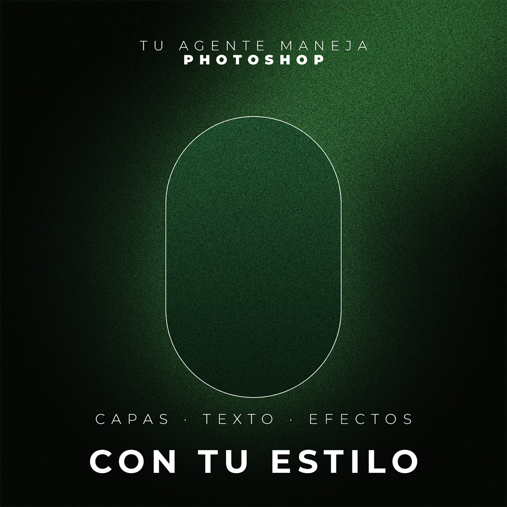

<div align="center">

# Free Photoshop MCP

**Pídele a tu agente de IA el diseño que quieres en Photoshop. Él lo arma, lo mira y lo corrige, con tu estilo.**

*by [Videazo Super Intelligence](https://videazo.si/intelligence)*


**Claude · Codex · Cursor · Gemini CLI · Windsurf**

[Descargar el ZIP](https://github.com/joshcreativos-ctrl/photoshop-mcp/archive/refs/heads/main.zip) · [Página](https://videazo.si/photoshop-mcp)



<sub>Esta pieza la hizo un agente con este MCP: degradado, luz borrosa en screen, grano en overlay, forma con trazo y resplandor, y texto por tramos, con un estilo guardado.</sub>

</div>

---

## Qué es

Un servidor [MCP](https://modelcontextprotocol.io) que conecta a tu agente con **Adobe Photoshop**. Va más allá de "poner un texto": trabaja como un diseñador.

- **Entiende el proyecto**: tamaño, resolución, modo de color, profundidad, perfil ICC, guías, artboards, y **qué recursos usa** (fuentes instaladas o no, archivos vinculados, bibliotecas de Creative Cloud, objetos inteligentes).
- **Trabaja con todo lo avanzado**: capas y grupos, texto con control tipográfico completo (tramos Light + Black en el mismo bloque, tracking, interlineado, ejes de fuentes variables), formas vectoriales, **sombras apiladas, resplandores, bisel, satinado, trazos, degradados**, **todos los modos de fusión**, relleno vs. opacidad, «Mezclar si», máscaras (de capa, de recorte, vectoriales, degradadas), capas de ajuste, filtros (también como filtros inteligentes), selecciones, objetos inteligentes, quitar fondo con IA, historial.
- **Ve lo que hace**: `ps_preview` le devuelve la imagen para que corrija solo.
- **Aprende tu estilo**: `ps_style_analyze` lee tus PSD terminados y extrae paleta (la real del render), tipografía por jerarquía, recetas de efectos, hábitos de mezcla/relleno, formas, estructura de capas y maquetación. Lo guarda y lo aplica con `preset:'titulo'` y `effects:{recipe:'…'}`.
- **Sin instalar nada dentro de Photoshop**: se conecta por COM. Cada herramienta que cambia algo queda en **un solo paso del historial** (`Videazo · …`, Ctrl+Z).

Es gratis y de código abierto (MIT). No abre puertos de red ni envía tus archivos a ningún servidor.

## Qué puedes pedirle

```text
Crea un carrusel de 3 diapositivas 1:1 en un solo lienzo, fondo casi negro con luz verde,
y pon el título «EL COMBUSTIBLE PARA RESPLANDECER» con mi estilo. Mírala y corrígela.

Lee mi carrusel.psd y aprende mi estilo. Luego dime qué fuentes y efectos uso.

Dime qué recursos usa este PSD y si falta alguno (fuentes, vínculos).

Duplica este diseño a 4:5 para Instagram y exporta cada diapositiva en PNG.
```

## Instalar (Windows)

**Requisitos:** Photoshop (probado en la **2026**, versión 27), [Node.js 18+](https://nodejs.org) y un agente compatible con MCP.

### Opción A · Pega este prompt en tu agente

```text
Instala Free Photoshop MCP by Videazo Super Intelligence en mi computador (Windows). Pídeme confirmación antes de instalar:
1. Comprueba que uso Windows, que tengo Photoshop y Node.js 18 o más.
2. Dentro de la carpeta del proyecto ejecuta `node install.mjs --dry-run` y muéstrame qué va a hacer.
3. Con mi sí, ejecuta `node install.mjs`. No necesita administrador.
4. Dime que reinicie mi agente y pruébalo con la herramienta ps_status.
```

### Opción B · Doble clic
Abre **`Instalar.cmd`**.

### Opción C · A mano
`node install.mjs`. Opciones: `--dry-run`, `--uninstall`, `--no-claude-code`, `--no-claude-desktop`, `--no-codex`, `--no-cursor`, `--no-gemini`, `--no-windsurf`.

El instalador copia el servidor a `%LOCALAPPDATA%\Videazo\ps-mcp` y lo registra como `photoshop` en los agentes que tengas. No toca Photoshop.

## Cómo trabaja

```
Agente ⇄ MCP (stdio) ⇄ server.mjs ⇄ PowerShell/COM ⇄ Photoshop (ExtendScript + Action Manager)
```

Las operaciones se escriben una sola vez en `jsx/` (biblioteca ExtendScript) y se envían con cada orden. Todo el Action Manager se serializa a JSON reversible (`{_c:'clase'}`, `{_u:'pixelsUnit',v}`, `{_e:[tipo,valor]}`…), por eso un estilo de capa se puede **capturar y volver a aplicar exacto**.

## Herramientas

| Grupo | Herramientas |
|---|---|
| Proyecto | `ps_status` `ps_open` `ps_new_document` `ps_document_info` `ps_project_report` `ps_resources` `ps_set_document` `ps_create_artboard` `ps_save` `ps_close` `ps_export` `ps_history` |
| Ver | `ps_preview` `ps_palette` `ps_layers` `ps_layer_info` `ps_text_info` `ps_fonts` |
| Crear | `ps_add_text` `ps_add_shape` `ps_create_layer` `ps_place_image` `ps_add_adjustment` `ps_batch` |
| Modificar | `ps_edit_text` `ps_set_layer` `ps_layer_style` `ps_mask` `ps_filter` `ps_selection` `ps_fill` `ps_smart_object` `ps_remove_background` |
| Organizar | `ps_group` `ps_duplicate_layer` `ps_delete_layer` `ps_merge_rasterize` `ps_align` |
| Estilo | `ps_style_analyze` `ps_style_list` `ps_style_get` `ps_style_set` `ps_capture_style` |
| Salida libre | `ps_action_manager` `ps_execute_script` `ps_run_action` `ps_run_script_file` |

## Aprender tu estilo

1. `ps_style_analyze` con tus PSD terminados (los abre, los lee y los cierra sin guardar).
2. Se guarda en `%APPDATA%\Videazo\photoshop-mcp\styles\<nombre>.json` y `.md` (la guía).
3. Antes de diseñar, tu agente lee `ps_style_get` y sigue la guía. En las llamadas usa `preset:'titulo'` y `effects:{recipe:'sombra-x3+resplandor-verde'}`.
4. Afina con `ps_style_set` (presets, colores con nombre, notas) o guarda cualquier capa que te guste con `ps_capture_style name:'…'`.

## Solución de problemas

- **No responde:** Photoshop no atiende órdenes con un cuadro de diálogo abierto. Ciérralo.
- **Fuente no encontrada:** `ps_fonts query:'nombre'` y usa el nombre PostScript.
- **Primer uso lento:** la primera llamada conecta con Photoshop (y lo abre si estaba cerrado).
- **Análisis de un PSD muy pesado:** tarda más porque Photoshop debe leer cada capa; el análisis tiene un presupuesto de tiempo y avisa si se truncó.

## Límites honestos

- Solo Windows (usa COM).
- Photoshop es de Adobe; este proyecto no está afiliado a Adobe. Los nombres se usan solo para indicar compatibilidad.
- Funciones que dependen de servicios en la nube de Adobe (relleno generativo) no se exponen directamente; usa `ps_action_manager`.

## Licencia

MIT.
